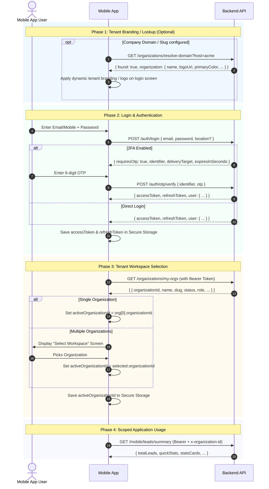

# Truroot Mobile App: Tenant & Authentication API Specification

**Target Platforms:** Flutter, React Native, Native Android (Kotlin), Native iOS (Swift)  
**Architecture:** Multi-Tenant SaaS with JWT Bearer Auth & Dynamic Tenant Isolation  
**Date:** October 2026  
**Status:** Implemented in Backend (`apps/api`) & Production Ready

---

## 1. Architectural Overview

The Truroot platform operates as a **Multi-Tenant SaaS**. Unlike earlier single-tenant mobile builds where all users belonged to a single hardcoded database instance:
1. **Identities are Platform-Wide, Memberships are Tenant-Scoped:** A user account (email/mobile) has memberships (`OrganizationMember`) across one or more tenant organizations.
2. **Dynamic Tenant Context:** All business APIs (CRM, Leads, Teams, Employees, Projects, etc.) require an active tenant workspace header (`x-organization-id` or `x-tenant-id`).
3. **Cookie-Free Mobile Authentication:** Web uses `HttpOnly` cookies, but mobile clients must store the `accessToken` and `refreshToken` securely on the device and pass tokens via HTTP headers and request bodies.
4. **Daily Session Policy:** Daily sessions expire automatically at 7:30 PM IST cutoff via Redis. Mobile apps must catch this and redirect to login.

---

## 2. Global Headers & Conventions

### Base URLs
- **Production API:** `https://crmtrueroot.com/api`
- **Staging / QA:** `https://staging.crmtrueroot.com/api`
- **Local Dev:** `http://<YOUR_LOCAL_IP>:5002/api`

### Request Headers

| Header Name | Required For | Description | Example |
|---|---|---|---|
| `Content-Type` | `POST`, `PATCH`, `PUT` | Always `application/json` | `application/json` |
| `Authorization` | All protected endpoints | Bearer token format | `Bearer eyJhbGciOiJIUzI1Ni...` |
| `x-organization-id` | All tenant-scoped endpoints | UUID of the selected tenant workspace | `550e8400-e29b-41d4-a716-446655440000` |
| `x-tenant-id` | Alternative to `x-organization-id` | Same as `x-organization-id` | `550e8400-e29b-41d4-a716-446655440000` |
| `x-tenant-slug` | Alternative lookup | Organization slug | `trueroot` |

> **Important Mobile Rule:** Once the user logs in and selects a workspace, the mobile HTTP client (e.g. Dio in Flutter or Axios) must automatically attach both `Authorization: Bearer <accessToken>` and `x-organization-id: <activeOrgId>` on every request.

---

## 3. Recommended Mobile App Lifecycle Flow



---

## 4. Endpoints Reference: Tenant Management

### 4.1. Resolve Domain / Slug (Public)
Used to identify a tenant workspace by company slug or custom domain before login. Useful for displaying custom logos and brand colors on the mobile login screen.

- **Method:** `GET`
- **Path:** `/organizations/resolve-domain`
- **Auth Required:** No (Public)
- **Query Parameters:**
  - `host` *(string, required)*: Subdomain slug (e.g. `trueroot`, `skyline`) or custom domain (e.g. `crm.clientdomain.com`).

#### Request Example
```http
GET /api/organizations/resolve-domain?host=trueroot HTTP/1.1
Host: crmtrueroot.com
```

#### Response Example (`200 OK`)
```json
{
  "found": true,
  "organization": {
    "id": "c3b88950-8dc4-4d2b-980b-df087db4cf81",
    "name": "Truroot Real Estate",
    "slug": "trueroot",
    "logoUrl": "https://s3.ap-south-1.amazonaws.com/uploads/org-logo.png",
    "brandingPrimaryColor": "#0D1F3D",
    "brandingSecondaryColor": "#E20613",
    "status": "ACTIVE",
    "showLogoInLogin": true,
    "loginCms": null
  }
}
```

If tenant not found:
```json
{
  "found": false
}
```

---

### 4.2. Get User's Organizations (`my-orgs`)
Returns all tenant workspaces to which the authenticated user has active access. **Must be called immediately after login.**

- **Method:** `GET`
- **Path:** `/organizations/my-orgs`
- **Auth Required:** Yes (`Bearer <accessToken>`)
- **Headers:**
  ```http
  Authorization: Bearer <accessToken>
  ```

#### Response Example (`200 OK`)
```json
[
  {
    "organizationId": "c3b88950-8dc4-4d2b-980b-df087db4cf81",
    "name": "Truroot Real Estate",
    "slug": "trueroot",
    "customDomain": null,
    "status": "ACTIVE",
    "setupFeePaid": true,
    "planTier": "GROWTH",
    "allocatedSeats": 25,
    "role": "SALES_MANAGER",
    "isOwner": false
  }
]
```

#### Tenant Status Values
| Status | Meaning for Mobile App |
|---|---|
| `ACTIVE` | Workspace is ready for use. Proceed to main screens. |
| `SETUP_PENDING` | Organization setup fee is unpaid. App should block dashboard and prompt user to contact administrator. |
| `SUSPENDED` / `CANCELLED` | Organization workspace disabled. Block dashboard with message. |

---

### 4.3. Get Current Organization Profile
Returns details and member lists for the currently active workspace.

- **Method:** `GET`
- **Path:** `/organizations/current`
- **Auth Required:** Yes
- **Headers:**
  ```http
  Authorization: Bearer <accessToken>
  x-organization-id: <organizationId>
  ```

#### Response Example (`200 OK`)
```json
{
  "id": "c3b88950-8dc4-4d2b-980b-df087db4cf81",
  "name": "Truroot Real Estate",
  "slug": "trueroot",
  "status": "ACTIVE",
  "planTier": "GROWTH",
  "allocatedSeats": 25,
  "industry": "Real Estate",
  "city": "Mumbai",
  "brandingPrimaryColor": "#0D1F3D",
  "brandingSecondaryColor": "#E20613",
  "logoUrl": "https://s3.ap-south-1.amazonaws.com/uploads/org-logo.png",
  "memberships": [
    {
      "id": "e6741b65-6677-4482-9993-9c882a17ba81",
      "userId": "9090aa11-1234-4567-89ab-cdef01234567",
      "role": "SALES_MANAGER",
      "user": {
        "id": "9090aa11-1234-4567-89ab-cdef01234567",
        "fullName": "Afreen Khan",
        "email": "afreen@truroot.in",
        "role": "SALES_MANAGER",
        "isActive": true
      }
    }
  ]
}
```

---

### 4.4. Get Workspace Settings & Localization
Provides workspace settings including timezone, date format, currency, and company profile.

- **Method:** `GET`
- **Path:** `/organizations/workspace-settings`
- **Auth Required:** Yes
- **Headers:**
  ```http
  Authorization: Bearer <accessToken>
  x-organization-id: <organizationId>
  ```

#### Response Example (`200 OK`)
```json
{
  "profile": {
    "companyName": "Truroot Real Estate",
    "tenantCode": "TRUEROOT",
    "industry": "Real Estate",
    "primaryEmail": "info@truroot.in",
    "primaryPhone": "+919876543210",
    "primaryColor": "#0D1F3D",
    "secondaryColor": "#E20613",
    "logoUrl": "https://s3.ap-south-1.amazonaws.com/uploads/org-logo.png"
  },
  "localization": {
    "timezone": "Asia/Kolkata",
    "dateFormat": "DD/MM/YYYY",
    "timeFormat": "12-Hour",
    "language": "en-US",
    "numberFormat": "lakhs"
  },
  "financial": {
    "currency": "INR"
  }
}
```

---

## 5. Endpoints Reference: Authentication & Login

### 5.1. Password Login
Authenticates user using email or mobile number with password. Optional GPS location can be sent for security audit and attendance.

- **Method:** `POST`
- **Path:** `/auth/login`
- **Auth Required:** No
- **Rate Limit:** 5 requests per 10 minutes.

#### Request Body
```json
{
  "email": "user@example.com",
  "mobile": "+919876543210",
  "password": "SecretPassword123",
  "location": {
    "latitude": 19.0760,
    "longitude": 72.8777,
    "accuracy": 15.5
  }
}
```
*(Provide either `email` or `mobile`. `location` is optional).*

#### Scenario A: Direct Login Success (`200 OK`)
```json
{
  "accessToken": "eyJhbGciOiJIUzI1NiIsInR5cCI6IkpXVCJ9...",
  "refreshToken": "eyJhbGciOiJIUzI1NiIsInR5cCI6IkpXVCJ9...",
  "user": {
    "id": "9090aa11-1234-4567-89ab-cdef01234567",
    "email": "afreen@truroot.in",
    "role": "SALES_MANAGER",
    "fullName": "Afreen Khan",
    "image": null,
    "permissions": [
      {
        "moduleKey": "leads",
        "canView": true,
        "canCreate": true,
        "canUpdate": true,
        "canDelete": false,
        "canPunchIn": true,
        "canPunchOut": true
      }
    ]
  }
}
```

#### Scenario B: 2FA / OTP Required (`200 OK`)
When 2-Factor Authentication is enabled for the role:
```json
{
  "requiresOtp": true,
  "identifier": "afreen@truroot.in",
  "deliveryTarget": "registered phone ending 3210",
  "expiresInSeconds": 300,
  "resendAfterSeconds": 30,
  "message": "OTP sent to your registered phone number"
}
```
*(Prompt user for 6-digit OTP and call `/auth/otp/verify`).*

#### Error Responses
- `401 Unauthorized` (`Invalid credentials`): Incorrect email/mobile or password.
- `401 Unauthorized` (`Incorrect password. You have X attempts remaining before your account is deactivated`): Failed attempts warning.
- `401 Unauthorized` (`Your account has been deactivated due to 5 consecutive failed login attempts`): Account locked out.
- `401 Unauthorized` (`Your account is deactivated. Please contact an administrator`): Account disabled by admin.
- `401 Unauthorized` (`Your organization workspace has been suspended or disabled`): Workspace inactive.

---

### 5.2. Verify Login OTP
Submits the 6-digit OTP to complete two-factor authentication.

- **Method:** `POST`
- **Path:** `/auth/otp/verify`
- **Auth Required:** No
- **Rate Limit:** 10 requests per 10 minutes.

#### Request Body
```json
{
  "identifier": "afreen@truroot.in",
  "otp": "492810",
  "location": {
    "latitude": 19.0760,
    "longitude": 72.8777,
    "accuracy": 12.0
  }
}
```

#### Response Example (`200 OK`)
Same as direct login success:
```json
{
  "accessToken": "eyJhbGciOiJIUzI1NiIsInR5cCI6IkpXVCJ9...",
  "refreshToken": "eyJhbGciOiJIUzI1NiIsInR5cCI6IkpXVCJ9...",
  "user": {
    "id": "9090aa11-1234-4567-89ab-cdef01234567",
    "email": "afreen@truroot.in",
    "role": "SALES_MANAGER",
    "fullName": "Afreen Khan",
    "image": null,
    "permissions": [ ... ]
  }
}
```

---

### 5.3. Request / Resend Login OTP
Used to resend an OTP code if the timer expires.

- **Method:** `POST`
- **Path:** `/auth/otp/request`
- **Auth Required:** No
- **Rate Limit:** 5 requests per 10 minutes.

#### Request Body
```json
{
  "identifier": "afreen@truroot.in"
}
```

#### Response Example (`200 OK`)
```json
{
  "success": true,
  "message": "OTP has been sent to your registered phone number",
  "expiresInSeconds": 300,
  "resendAfterSeconds": 30,
  "deliveryTarget": "registered phone ending 3210"
}
```

---

### 5.4. Refresh Token (Crucial for Mobile)
Access tokens expire after **8 hours**. The refresh token is valid for **7 days**. When a request returns `401 Unauthorized`, the mobile app must call this endpoint to renew tokens.

- **Method:** `POST`
- **Path:** `/auth/refresh`
- **Auth Required:** No (sends refresh token in body)

#### Request Body (Mobile Specific)
```json
{
  "refreshToken": "eyJhbGciOiJIUzI1NiIsInR5cCI6IkpXVCJ9..."
}
```

#### Response Example (`200 OK`)
```json
{
  "accessToken": "eyJhbGciOiJIUzI1NiIsInR5cCI6IkpXVCJ9_NEW_ACCESS...",
  "refreshToken": "eyJhbGciOiJIUzI1NiIsInR5cCI6IkpXVCJ9_NEW_REFRESH...",
  "user": {
    "id": "9090aa11-1234-4567-89ab-cdef01234567",
    "email": "afreen@truroot.in",
    "role": "SALES_MANAGER",
    "fullName": "Afreen Khan",
    "image": null,
    "permissions": [ ... ]
  }
}
```
*(Store the new `accessToken` and `refreshToken` immediately).*

---

### 5.5. Get Current Session User
Fetches current user profile and permission list using the access token.

- **Method:** `GET`
- **Path:** `/auth/session`
- **Auth Required:** Yes
- **Headers:**
  ```http
  Authorization: Bearer <accessToken>
  ```

#### Response Example (`200 OK`)
```json
{
  "id": "9090aa11-1234-4567-89ab-cdef01234567",
  "email": "afreen@truroot.in",
  "role": "SALES_MANAGER",
  "fullName": "Afreen Khan",
  "image": null,
  "permissions": [ ... ]
}
```

---

### 5.6. Logout
Invalidates the refresh token in Redis and ends the user's active session.

- **Method:** `POST`
- **Path:** `/auth/logout`
- **Auth Required:** Optional (bearer token if available)

#### Request Body
```json
{
  "refreshToken": "eyJhbGciOiJIUzI1NiIsInR5cCI6IkpXVCJ9..."
}
```

#### Response Example (`200 OK`)
```json
{
  "success": true
}
```

---

## 6. Public Mobile APK Release & Update Checks

The API includes endpoints for mobile version checks and OTA APK downloads:

### 6.1. Get Current Mobile App Release Info
- **Method:** `GET`
- **Path:** `/public/mobile-app`
- **Auth Required:** No

#### Response Example (`200 OK`)
```json
{
  "id": "b3e34a70-4965-4d04-8902-6019b8ea0e15",
  "version": "1.2.0",
  "buildNumber": 12,
  "changelog": "Multi-tenant workspace support, improved lead filters, bug fixes",
  "isCritical": false,
  "downloadUrl": "/api/public/mobile-app/download",
  "createdAt": "2026-10-01T10:00:00.000Z"
}
```

### 6.2. Download Latest APK
- **Method:** `GET`
- **Path:** `/public/mobile-app/download`
- **Response:** HTTP `302 Redirect` to direct S3/Storage download URL.

---

## 7. Mobile App Implementation Guide (Dart / Flutter Example)

Below is the reference pattern for implementing the HTTP client and interceptor in Flutter with `dio` and `flutter_secure_storage`:

```dart
import 'package:dio/dio.dart';
import 'package:flutter_secure_storage/flutter_secure_storage.dart';

class ApiClient {
  static const storage = FlutterSecureStorage();
  late final Dio dio;

  ApiClient({String baseUrl = 'https://crmtrueroot.com/api'}) {
    dio = Dio(BaseOptions(
      baseUrl: baseUrl,
      connectTimeout: const Duration(seconds: 15),
      receiveTimeout: const Duration(seconds: 15),
    ));

    dio.interceptors.add(InterceptorsWrapper(
      onRequest: (options, handler) async {
        // 1. Attach JWT Access Token
        final token = await storage.read(key: 'accessToken');
        if (token != null && token.isNotEmpty) {
          options.headers['Authorization'] = 'Bearer $token';
        }

        // 2. Attach Selected Multi-Tenant Organization ID
        final orgId = await storage.read(key: 'activeOrganizationId');
        if (orgId != null && orgId.isNotEmpty) {
          options.headers['x-organization-id'] = orgId;
        }

        return handler.next(options);
      },
      onError: (DioException error, handler) async {
        final statusCode = error.response?.statusCode;
        final responseData = error.response?.data;
        final message = responseData is Map ? responseData['message'] : '';

        // Check if account is deactivated or daily 7:30 PM session cutoff reached
        if (statusCode == 401 &&
            (message.toString().contains('Daily session expired') ||
             message.toString().contains('deactivated'))) {
          await _clearSessionAndGoToLogin();
          return handler.reject(error);
        }

        // Handle Token Expiry: 401 on protected requests
        if (statusCode == 401 && !error.requestOptions.path.contains('/auth/')) {
          final refreshed = await _refreshToken();
          if (refreshed) {
            // Retry the original request with new token
            final newToken = await storage.read(key: 'accessToken');
            error.requestOptions.headers['Authorization'] = 'Bearer $newToken';
            final response = await dio.fetch(error.requestOptions);
            return handler.resolve(response);
          } else {
            await _clearSessionAndGoToLogin();
          }
        }

        return handler.next(error);
      },
    ));
  }

  Future<bool> _refreshToken() async {
    try {
      final refreshToken = await storage.read(key: 'refreshToken');
      if (refreshToken == null) return false;

      // Note: Must pass refreshToken in body for mobile apps!
      final res = await Dio().post(
        'https://crmtrueroot.com/api/auth/refresh',
        data: {'refreshToken': refreshToken},
      );

      if (res.statusCode == 200 && res.data != null) {
        final newAccess = res.data['accessToken'];
        final newRefresh = res.data['refreshToken'];
        await storage.write(key: 'accessToken', value: newAccess);
        await storage.write(key: 'refreshToken', value: newRefresh);
        return true;
      }
      return false;
    } catch (_) {
      return false;
    }
  }

  Future<void> _clearSessionAndGoToLogin() async {
    await storage.deleteAll();
    // Navigate to Login Screen
  }
}
```

---

## 8. Summary Checklist for Mobile Team

- [x] **Send `refreshToken` in request body:** Mobile doesn't use cookies. Pass `{ "refreshToken": "..." }` to `/auth/refresh` and `/auth/logout`.
- [x] **Fetch workspaces after login:** Always call `GET /organizations/my-orgs` after logging in.
- [x] **Store `activeOrganizationId`:** Save the selected organization ID to device secure storage.
- [x] **Attach `x-organization-id` header:** Every CRM, lead, attendance, or dashboard request must carry `x-organization-id: <orgId>` alongside `Authorization: Bearer <token>`.
- [x] **Handle 7:30 PM session reset:** Handle `Daily session expired at 7:30 PM` 401 response by showing a friendly prompt and directing to login.
- [x] **Check for app updates on startup:** Call `GET /public/mobile-app` on launch to notify users of available updates.
